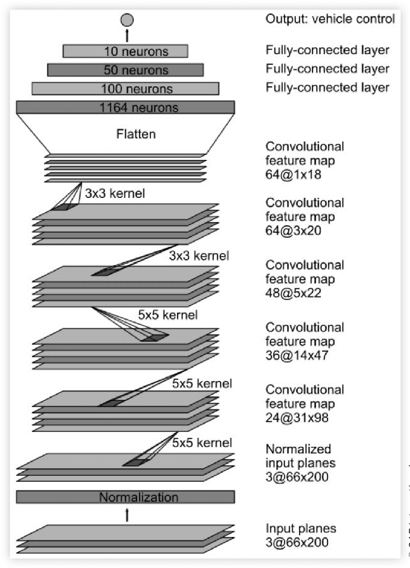

# PilotNet

Nvidia'nın 2016 tarihli "End to End Learning for Self-Driving Cars" başlıklı makalesinde yer alan DAVE-2 sistemindeki CNN tabanlı mimarinin adı PilotNet'tir. İsmini 2017'de koymuşlar. Bu yüzden bu çalışmada DAVE-2 mimarisinden çok PilotNet'e odaklanmak istiyorum.

## Veri Toplama

Eğitim verisi, farklı yol koşullarında ve çeşitli hava durumlarında toplanmıştır. Çoğu yol verisi New Jersey'de elde edilmiştir; ancak otoyol verileri Illinois, Michigan, Pennsylvania ve New York'tan toplanmıştır. Veri, elektronik kontrollü sürüş sistemi bulunan 2016 Lincoln MKZ ve 2013 Ford Focus araçlarına 3 kamera yerleştirilerek kaydedilmiştir.

Benim durumumda ise CAN-bus'tan direksiyon açısı verisini okumadığım için bu verileri simülasyondan elde ettim. Udacity'nin Self-Driving Car Sim'inde aynı mantık geçerliydi; burada da 3 kamera bulunuyordu. Record özelliğini kullanarak kendi sürüş verilerimi kaydettim.

## Modelin Mimarisi

Normalde Nvidia'nın modelinin ilk katmanında görüntünün normalizasyonu ve YUV renk uzayına dönüştürülmesi yer alır. Ben ise görüntüleri önceden işleyip verdiğim için bu ilk katman modelimde bulunmuyor.

> Not: RGB renk uzayı yerine YUV kullanılmasının temel nedeni, YUV'de parlaklık bilgisinin ayrı tutulmasıdır. Bu sayede ani ışık değişimlerinde, RGB'de görülen renk değerlerindeki dalgalanmalar daha az hissedilir.

Ağ; 1 normalizasyon katmanı, 5 evrişim katmanı ve 3 tam bağlı katman olmak üzere toplam 9 katmandan oluşur. Giriş görüntüsü YUV düzlemlerine ayrıştırılır ve ağın girişine aktarılır. Tekrar belirtmek gerekirse, benim modelimde normalizasyon katmanı yok; bunun gerekli olmadığı düşüncesiyle bu katmanı kaldırdım.

Evrişim katmanları özellik çıkarımı için tasarlanmıştır ve sayıları Nvidia'nın deneyine göre seçilmiştir. İlk üç evrişim katmanında 2x2 stride ve 5x5 kernel kullanılırken, kalan son iki evrişim katmanında 3x3 kernel ve stride kullanılmamıştır.

> Not: Başlangıçta aklıma şu soru takıldı: neden pooling katmanı kullanılmadı? Cevabı oldukça basit: Yolun hangi bölümünde olduğumuzun belirlenmesi, piksel konumuna bağlıdır. Bu durum, object detection veya classification gibi görevlerde olduğu kadar önemli değildir; burada konum bilgisi kritik öneme sahiptir. O halde parametre sayısını nasıl düşürdüler? Cevap: stride kullanarak.

Bu beş evrişim katmanının çıktısı, direksiyon açısını kontrol eden katmanlarla ilişkilendirilir. Benim durumumda, direksiyon açısı çıktısı olarak alınırken, dönüş yarıçapının tersi (yani $1/r$) gibi bir gösterim kullanılmıştır. Bu nedenle, 3 tam bağlı katman direksiyon komutunu modelin çıktısına dönüştüren kısım olarak düşünülebilir. Bu cümle biraz uzun geldi; ama aslında burada dikkat çekici olan nokta, modelin hangi kısmının özellik çıkarımı, hangi kısmının ise direksiyon kontrolü yaptığı ayrımının net bir şekilde belirlenmesinin son derece zor olmasıdır.

Tam bağlı katmanlar, steering kontrolünü sağlamak için tasarlanmış olsa da, modelin hangi bölümünün özellik çıkarımı yaptığı ile hangi bölümünün yön kontrolü yaptığı ayrımının belirlenmesi neredeyse imkânsızdır.

> Not: ReLU (Rectified Linear Unit) aktivasyon fonksiyonunun yapısı nedeniyle "Dying ReLU" problemini çözmek için ELU kullandım. Yapay sinir ağlarında ölen ReLU problemi, ReLU aktivasyon fonksiyonunu kullanan bir nöronun sürekli 0 çıktısı üretmesi ve bir daha aktifleşememesi durumu olarak tanımlanır.
>
> - Negatif Girdi: ReLU, girdi 0'dan küçük veya eşit olduğunda $x \le 0$ için 0 çıktısı verir ve bu bölgedeki türev de 0 olur.
> - Büyük Gradyanlar: Eğitim sırasında nöron üzerinden çok büyük bir gradyan geçmesi, ağın ağırlıklarını öyle güncelleyebilir ki nöron artık pozitif bir giriş alamaz hale gelir.
> - Sıfır Türev: Gradyan 0 olduğunda geri yayılım (backpropagation) sırasında ağırlık güncellemeleri durur; nöron kalıcı olarak "ölür" ve bir daha öğrenemez.
> - Yüksek Öğrenme Oranı: Öğrenme oranı çok yüksek ayarlanırsa bu risk artar.

## Augmentation (Artırma)

Resimleri batchler halinde çoğalttım. Bunun için bir batch generator yazdım. Görüntüleri öteledim, ışık ayarlarını değiştirdim ve döndürdüm. Öncesinde çok fazla 0 derece açı olduğu için bir eşik belirledim; bu eşik değerinin üzerindeki açıları eğitim setinden çıkardım.

İlk başta yalnızca ortadaki kamerayı kullandım; ancak bu, arabanın recovery (kurtarma) davranışını yeterince öğrenemememe neden oldu. Bu yüzden diğer iki kamerayı da eğitim setine ekledim. Kameraların açılarını birkaç derece artırıp azaltarak veri setini zenginleştirdim. Sonuç olarak modelin performansı biraz daha iyi oldu; ancak işin sonunda DAgger kullanmak zorunda kaldım.

## Simülasyon

Udacity'nin Self-Driving Car Simulation ortamında modeli test ettim. Simülasyonda iki farklı pist vardı. İkinci pistin verileri test olarak kullanılmasın diye bilerek eklemedim; böylece veri sızıntısı riskini azaltmış oldum. Ancak bu pistin üzerinde daha fazla sürmem gerektiğini fark ettim.
